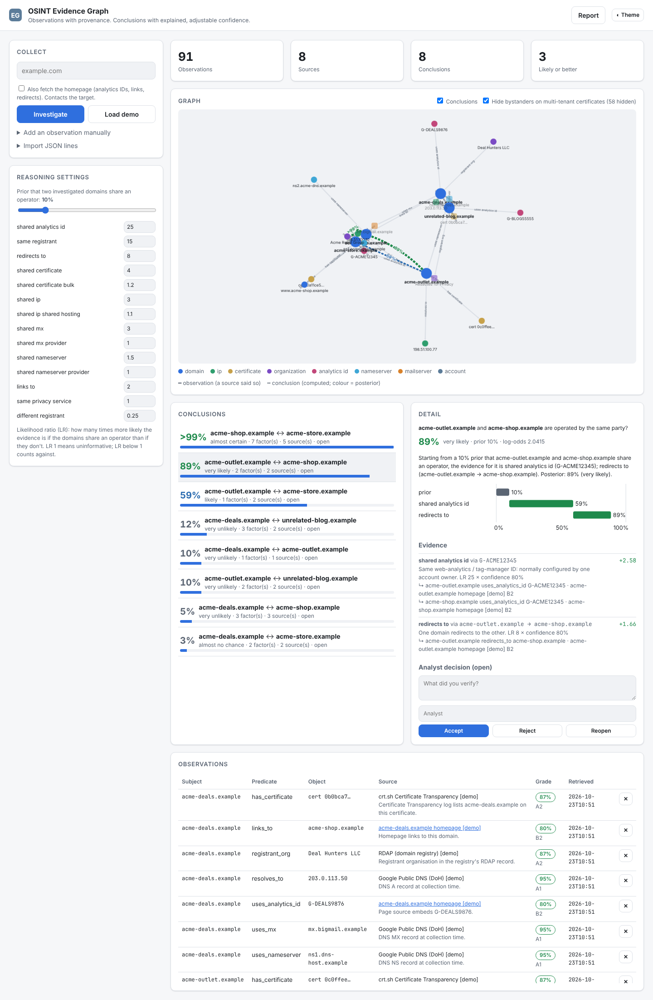

# OSINT Evidence Graph with Confidence Scoring

**Rather than just displaying connected entities, this graph gives every relationship a source, a timestamp, a confidence score and an explanation. Conclusions are computed and explained, never silently assumed.**



> Example: two domains share a TLS certificate. The system records that *observation*, with the CT log as its source, the retrieval time, the SHA-256 of the response and an Admiralty grade. It does **not** conclude that the domains belong to the same organisation. That question becomes a *hypothesis* whose probability you can see, audit and adjust.

## Model

| Layer | What it is | Example |
|---|---|---|
| **Entity** | A thing: domain, IP, certificate, organisation, analytics ID, nameserver, mail server | `acme-shop.example` |
| **Observation** | What a *source* reported, with provenance: source, URL, retrieved-at, SHA-256 of the raw response, method, Admiralty grade (A1–F6) → confidence, plain-language explanation | *crt.sh lists cert 0a11ce5 covering acme-store.example* |
| **Hypothesis** | A conclusion such as *same operator*, scored with Bayes' rule and never stored as fact | *acme-shop ↔ acme-store: >99%, almost certain* |
| **Decision** | An analyst accepts or rejects a hypothesis with a note. The reasoning at that moment is snapshotted. | *accepted: verified in WHOIS history* |

### How confidence is computed

```
logit(posterior) = logit(prior) + Σ confidenceᵢ · discountᵢ · ln(LRᵢ)
```

* **LR (likelihood ratio)** per kind of evidence, from an editable rulebook. A shared analytics ID has LR 25; a shared *CDN* IP has LR 1.1, because strangers share those all the time; a 60-name multi-tenant certificate has LR 1.2; a different, non-redacted registrant has LR 0.25, counting *against*.
* **Confidence** is the Admiralty-derived confidence of the underlying observations. For shared attributes the weaker of the two applies.
* **Discount**: repeated evidence of the same kind counts half as much each time, because it isn't independent.
* Infrastructure is classified when collected (CDN IP ranges via RDAP, big DNS and mail providers, privacy-redacted registrants), so the weak version of a rule applies automatically.

The UI draws each conclusion as a **waterfall** from the prior through every factor to the posterior. It lists each factor's LR, confidence and contribution, and traces every factor back to the observations and sources behind it.

## Collectors

`investigate(domain)` records observations from:

* **Certificate Transparency** (crt.sh): certificates and every name they cover; multi-tenant certificates are flagged
* **DNS-over-HTTPS**: A, NS and MX records. Large DNS and mail providers are flagged, and CDN address space is detected via **RDAP**.
* **RDAP**: registrant organisation, with privacy services flagged
* *(opt-in)* **homepage**: analytics and tag-manager IDs (GA4, UA, GTM, AdSense), outbound links and redirects. This contacts the target, so it is off by default.

You can also add observations by hand (a source is mandatory) or import JSON lines from passive DNS, archives or your own tools; see `samples/observations.jsonl`.

To keep big CDN certificates from producing thousands of meaningless pairs, hypotheses are proposed only between investigated ("seed") domains, or between a seed and a domain with at least one informative factor. Subdomains are folded into their parent.

## Quick start

```bash
git clone https://github.com/Sentinel1569/osint-evidence-graph.git && cd osint-evidence-graph
python -m venv .venv && source .venv/bin/activate
pip install -e ".[dev]"
python -m evgraph serve          # http://127.0.0.1:8000, then "Load demo"
```

```bash
python -m evgraph demo
python -m evgraph investigate example.com example.org --fetch-site
python -m evgraph import samples/observations.jsonl
python -m evgraph conclusions
python -m evgraph report > evidence-report.md
```

## Demo

Five fictional `.example` domains illustrate the full range of outcomes: a near-certain pair (shared analytics ID, registrant, certificate and dedicated IP); a privacy-redacted domain that is still linked by its analytics ID and a redirect; two unrelated sites on the same CDN IP and certificate, which stay near the prior; and an affiliate link outweighed by a different registrant. The demo data is produced in the raw formats of crt.sh, DoH, RDAP and HTML and runs through the real collectors.

## Tests

```bash
make test && make lint
```

## License

MIT. Bundles Cytoscape.js (MIT).
